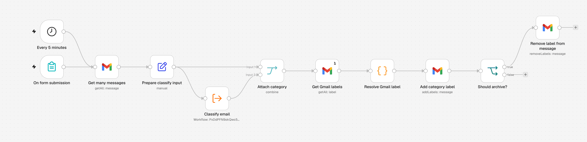
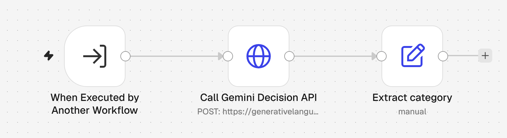
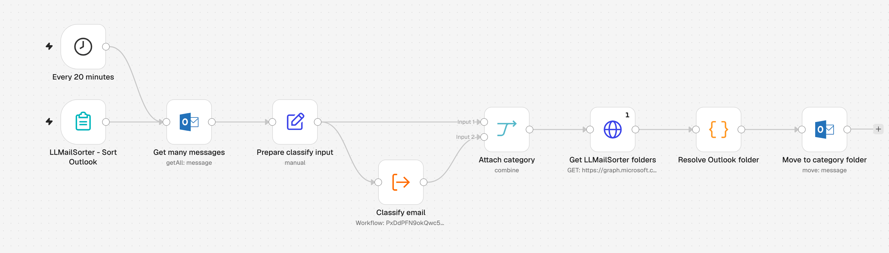
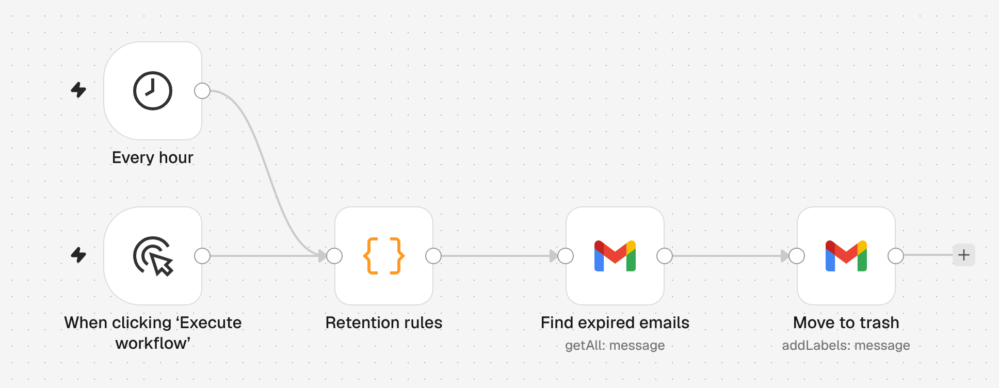
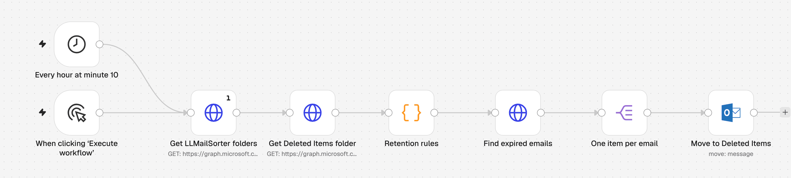

# LLMailSorter

LLMailSorter automatically sorts a Gmail or Outlook / Hotmail inbox. Every few
minutes, each new email is classified by an LLM (Google Gemini Decision 1) into one of ten
categories (invoices, jobs, orders, security, junk...) and filed under the
matching Gmail label or Outlook folder. A second set of workflows cleans up old
mail on a schedule, following per-category retention rules, while never
touching starred or flagged emails. It is self-hosted with Docker, and the logic
lives in n8n workflows that can be imported in a few clicks.

**Tech stack:** [n8n](https://n8n.io) (workflow automation), Docker Compose,
PostgreSQL, Google Gemini Decision 1 (`gemini-decision-1`, Decisions API), Gmail API, Microsoft Graph API
(Outlook / Hotmail).



<details>
<summary>More workflow screenshots</summary>

**Classify one email with Gemini** (`10-classify-email.json`)



**Sort Outlook / Hotmail** (`21-sort-outlook.json`)



**Clean up old Gmail emails** (`30-cleanup-gmail.json`)



**Clean up old Outlook emails** (`31-cleanup-outlook.json`)



</details>

## Quick start

Requirements: Docker Desktop (or Docker Engine + Compose).

```bash
cp .env.example .env          # then fill in the passwords
openssl rand -hex 32          # paste the output into N8N_ENCRYPTION_KEY
docker compose up -d
```

n8n is then available at http://localhost:5678.
Stop it with `docker compose down` (data is kept in Docker volumes).

Then:

- connect Gmail: see [docs/setup-google-oauth.md](docs/setup-google-oauth.md);
- connect Outlook / Hotmail: see
  [docs/setup-microsoft-oauth.md](docs/setup-microsoft-oauth.md);
- add the Gemini API key used to classify emails: see
  [docs/llm-provider.md](docs/llm-provider.md).

## Workflows

Workflows live in [`workflows/`](workflows/) as n8n JSON exports (without
credentials or pinned data). To use one:

1. In n8n, create a new workflow, open the **...** menu (top right) and choose
   **Import from File**.
2. Open each Gmail, Microsoft Outlook or HTTP Request node and select the
   matching credential.
3. Save.

| File | Purpose |
|---|---|
| `00-test-gmail.json` | Checks the Gmail connection: a form button that reads the 5 most recent emails, without modifying anything. |
| `00-test-outlook.json` | Same check for Outlook / Hotmail. |
| `01-create-gmail-labels.json` | Run once: creates the `LLMailSorter` Gmail label and its 10 category sub-labels. |
| `02-create-outlook-folders.json` | Run once: creates the `LLMailSorter` Outlook folder and its 10 category sub-folders. |
| `10-classify-email.json` | Sub-workflow that picks the category of one email with Gemini Decision 1. Returns `category` and `confidence`. See [docs/llm-provider.md](docs/llm-provider.md). |
| `20-sort-gmail.json` | Sorts the Gmail inbox: every 5 minutes (or from a form button), labels and archives up to 50 unlabelled emails. See [Sorting Gmail](#sorting-gmail). |
| `21-sort-outlook.json` | Sorts the Outlook inbox: every 20 minutes (or from a form button), moves up to 50 inbox emails to their category folder. See [Sorting Outlook](#sorting-outlook). |
| `30-cleanup-gmail.json` | Moves expired emails to the Gmail trash, every hour or on demand. Starred emails are never touched. See [Cleaning up old emails](#cleaning-up-old-emails). |
| `31-cleanup-outlook.json` | Moves expired emails to the Outlook Deleted Items folder, every hour at minute 10 or on demand. Flagged emails are never touched. See [Cleaning up old Outlook emails](#cleaning-up-old-outlook-emails). |

After importing `20-sort-gmail.json` or `21-sort-outlook.json`, also open its
**Classify email** node and select your `10 - Classify email` workflow:
workflow ids differ between n8n instances. In `21-sort-outlook.json`, also
select **Inbox** again in the **Folders to Include** filter of **Get many
messages**: folder ids differ between mailboxes.

## Before the first sort: clean up first

On a mailbox that already holds years of emails, **run the cleanup workflow by
hand before publishing the sorting workflow** (`30 - Cleanup Gmail` or
`31 - Cleanup Outlook`, with **Execute workflow**). Each run moves at most 500
emails per rule, so run it again until it no longer finds anything to move.

This way, the sorting workflow never classifies emails that are about to be
deleted anyway, and you do not spend Gemini API credits on them.

## Sorting Gmail

1. Import and run `01 - Create Gmail labels` once.
2. Clean up old emails first: see
   [Before the first sort](#before-the-first-sort-clean-up-first).
3. Publish `20 - Sort Gmail`. While n8n is running, the **Every 5 minutes**
   Schedule Trigger sorts new emails automatically. Emails received while n8n
   was stopped are caught up by the first run after it starts.
4. To sort a large backlog faster, open the workflow's form and submit it. Each
   run handles up to 50 emails; submit again until the inbox is sorted.

The interval is 5 minutes, not 1, because a run of 50 emails can take more than
a minute: a new run starting before the previous one ends could sort the same
emails twice.

Which emails are sorted: every inbox email without a user label
(`in:inbox has:nouserlabels`), read or unread. An email you labelled yourself is
left alone, and a sorted email is never sorted twice.

For each email, the workflow:

1. calls `10 - Classify email` with the sender, subject and body;
2. maps the returned category to a Gmail label (the `CATEGORY_LABELS` table in
   the **Resolve Gmail label** Code node);
3. adds that label, then archives the email (removes `INBOX`). The read/unread
   status is not changed.

| Category | Gmail label | Archived |
|---|---|---|
| `subscriptions` | `LLMailSorter/Subscriptions` | yes |
| `invoices` | `LLMailSorter/Invoices` | yes |
| `jobs` | `LLMailSorter/Jobs` | yes |
| `admin` | `LLMailSorter/Admin` | yes |
| `orders` | `LLMailSorter/Orders` | yes |
| `personal` | `LLMailSorter/Personal` | yes |
| `security` | `LLMailSorter/Security` | yes |
| `trash` | `LLMailSorter/Junk` | yes |
| `other` | `LLMailSorter/Other` | yes |
| `notSure` | `LLMailSorter/Not sure` | no, kept in the inbox for a manual check |

To change a label name or the archive setting, edit one line of
`CATEGORY_LABELS`. If you rename a label, rename it in Gmail too (or in
`01 - Create Gmail labels`, then run it again).

## Cleaning up old emails

`30 - Cleanup Gmail` moves emails that no longer need to be kept to the Gmail
trash. It runs every hour once the workflow is published (n8n does not catch up
on runs missed while it was stopped), and can also be run by hand with
**Execute workflow**, for example on a large mailbox before the first sort.

Safety rules:

- **Starred emails are never trashed**, whatever the rule. Star an email to keep
  it. Gmail's "important" marker is ignored.
- Emails go to the **trash**, never deleted for good: Gmail empties the trash
  after 30 days, so a mistake can be undone until then. Do not replace the
  **Move to trash** node with the Gmail **Delete** operation, which is
  permanent.
- No LLM is involved: the rules are plain Gmail searches.
- Each rule trashes at most 500 emails per run, to stay within Gmail API quotas.

The rules live in the `RETENTION_RULES` table of the **Retention rules** Code
node. Each row becomes a Gmail search such as
`older_than:7d -is:starred label:"LLMailSorter/Junk" -is:unread`.

| Gmail label | Kept for | Only if read |
|---|---|---|
| Everything (any email, sent ones included) | 3 years | no |
| `LLMailSorter/Junk` | 7 days | yes |
| `LLMailSorter/Subscriptions` | 30 days | yes |
| `LLMailSorter/Security` | 30 days | yes |
| `LLMailSorter/Not sure` | 30 days | yes |
| `LLMailSorter/Other` | 30 days | yes |
| `LLMailSorter/Orders` | 180 days | yes |
| `LLMailSorter/Jobs` | 2 years | yes |

`Invoices`, `Admin` and `Personal` have no row of their own: only the
Everything rule applies to them. Unread emails are left alone by the label
rules, so an email you have not opened yet only goes after 3 years.

To change a duration, edit `keepDays` in one row. To add a rule, add a row.

## Sorting Outlook

Outlook has no labels: each category is a sub-folder of `LLMailSorter`, and
moving an email there takes it out of the inbox.

1. Connect Outlook: see [docs/setup-microsoft-oauth.md](docs/setup-microsoft-oauth.md).
2. Import and run `02 - Create Outlook folders` once.
3. Clean up old emails first: see
   [Before the first sort](#before-the-first-sort-clean-up-first).
4. Publish `21 - Sort Outlook`. While n8n is running, the **Every 20 minutes**
   Schedule Trigger sorts new emails automatically, and its form sorts a
   backlog faster (50 emails per run).

Outlook runs less often than Gmail because Microsoft Graph quickly rejects
bursts of calls with `429 Too Many Requests`. Sorting runs at minutes 0, 20 and
40, and the cleanup at minute 10, so the two workflows never call Microsoft at
the same time.

Which emails are sorted: every email in the inbox, read or unread. A sorted
email has left the inbox, so it is never sorted twice. Moving an email does not
change its read/unread status.

For each email, the workflow:

1. calls `10 - Classify email` with the sender, subject and `bodyPreview` (the
   first 255 characters of the body, as plain text, provided by Microsoft);
2. maps the returned category to a folder (the `CATEGORY_FOLDERS` table in the
   **Resolve Outlook folder** Code node);
3. moves the email to that folder.

| Category | Outlook folder |
|---|---|
| `subscriptions` | `LLMailSorter/Subscriptions` |
| `invoices` | `LLMailSorter/Invoices` |
| `jobs` | `LLMailSorter/Jobs` |
| `admin` | `LLMailSorter/Admin` |
| `orders` | `LLMailSorter/Orders` |
| `personal` | `LLMailSorter/Personal` |
| `security` | `LLMailSorter/Security` |
| `trash` | `LLMailSorter/Junk` |
| `other` | `LLMailSorter/Other` |
| `notSure` | `LLMailSorter/Not sure` (check it from time to time) |

Unlike Gmail, `Not sure` emails also leave the inbox: an email in the inbox is
always an unsorted one.

## Cleaning up old Outlook emails

`31 - Cleanup Outlook` applies the same retention rules as
[the Gmail cleanup](#cleaning-up-old-emails), with the same durations, to the
`LLMailSorter` sub-folders. It runs every hour at minute 10 once published
(between two sorting runs, see [Sorting Outlook](#sorting-outlook)), and can be run
by hand with **Execute workflow**.

Safety rules:

- **Flagged emails are never moved**, whatever the rule. Flag an email to keep
  it.
- Emails are moved to the **Deleted Items** folder, where they can be restored.
  Do not replace the **Move** node with the Outlook **Delete** operation: it
  skips Deleted Items.
- Folder rules only move emails already read. The Everything rule (3 years)
  moves any email, read or unread, from every folder (sent ones included)
  except Deleted Items.
- No LLM is involved: each rule is a Microsoft Graph filter such as
  `receivedDateTime lt <date> and flag/flagStatus ne 'flagged' and isRead eq true`.
- Each rule moves at most 500 emails per run.

Microsoft Graph accepts only 4 requests at a time on the same mailbox
(`429 ApplicationThrottled`, "MailboxConcurrency limit"). The HTTP Request
node would otherwise send its 8 searches (one per rule) all at once, so
**Find expired emails** uses the **Batching** option (1 request per second),
and both Graph nodes retry up to 3 times, 5 seconds apart.

The rules live in the `RETENTION_RULES` table of the **Retention rules** Code
node, one row per sub-folder (`folder: null` is the Everything rule).
